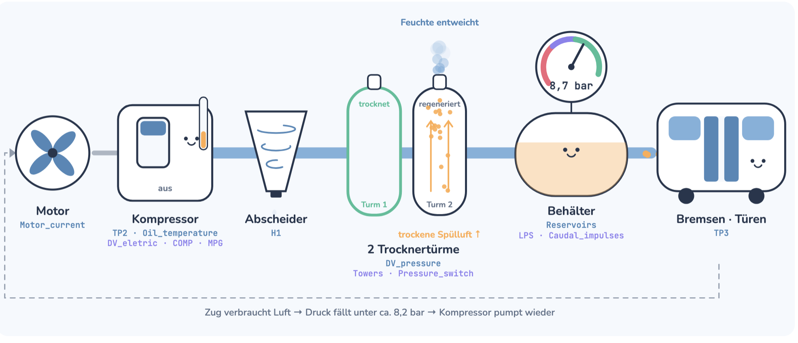

## Industrial IoT: Erkennung von Luftlecks für Predictive Maintenance
# Daten
https://www.kaggle.com/datasets/joebeachcapital/metropt-3-dataset
<br> Der Datensatz enthält echte Sensordaten (Feb.–Aug. 2020, sekündlich) des Luftkompressors eines Metro-Zugs in Porto. Der Kompressor versorgt Bremsen und Türen mit Druckluft. Im Zeitraum traten 4 Luftlecks auf, dokumentiert in den Wartungsberichten des Betreibers. Ziel ist es, diese frühzeitig zu erkennen, damit der Zug geplant gewartet werden kann, statt im Betrieb auszufallen.
- Echte Daten mit echten Ausfallberichten
- 8 digitale Signale, deren Zustandsänderungen (z. B. Kompressor ein/aus) als Ereignisse für OTALA dienen
- Nur 1 Maschine und 4 Ausfälle.
# Use Cases
1. Anomaly Detection: Erkennung von abnormalem Verhalten des Kompressors, mit SOM (analoge Signale) und OTALA (Schaltzyklen der digitalen Signale)
2. Predictive Maintenance: Frühwarnung vor Luftlecks, damit der Zug geplant in die Werkstatt kann, statt auf der Strecke auszufallen
# Vorgehen

> Training: **Feb – Mär 2020** (kein Ausfall) · Test: **Apr – Aug 2020** (4 Luftlecks)
> Failure Labels nur in Schritt 5 · Normierung nur auf Trainingsdaten · Lücken = Segmentgrenzen

- [x] **01. EDA** — Signalanalyse, Datenqualität, Lücken, Verteilungen, Korrelationen
- [x] **02. Cleaning** — TP3 & Caudal_impulses entfernen, Negativwerte → 0, Segmentierung
- [x] **03. OTALA** — Digitale Schaltzyklen (COMP, MPG, LPS, Towers …)
- [ ] **04. Features**
- [ ] **05. SOM** — Analoge Signale: Training auf Normalbetrieb, Anomalie-Score auf Testdaten
- [ ] **06. Evaluation** — Scores gegen Failure Events #1–#4: Trefferrate, Frühwarnzeit, Fehlalarme

# Failure Events (from maintenance reports)

| Nr. | Start               | End                 | Severity    | Maintenance         |
|-----|---------------------|---------------------|-------------|---------------------|
| #1  | 2020-04-18 00:00    | 2020-04-18 23:59    | High stress | —                   |
| #2  | 2020-05-29 23:30    | 2020-05-30 06:00    | High stress | 2020-04-30 12:00    |
| #3  | 2020-06-05 10:00    | 2020-06-07 14:30    | High stress | 2020-06-08 16:00    |
| #4  | 2020-07-15 14:30    | 2020-07-15 19:00    | High stress | 2020-07-16 00:00    |

# Projektstruktur

```
anomaly_air_leakage/
├── data/
│   ├── MetroPT3(AirCompressor).csv   # Rohdaten (Kaggle)
│   └── processed/
│       ├── df_raw.parquet            # gespeichert nach 01.EDA
│       └── df_clean.parquet          # gespeichert nach 02.Cleaning
├── notebooks/
│   ├── 00.Kick-Off.md
│   ├── 01.EDA.ipynb
│   ├── 02.Cleaning.ipynb
│   ├── 03.OTALA.ipynb
│   ├── 04.Features.ipynb
│   ├── 05.SOM.ipynb
│   └── 06.Evaluation.ipynb
├── results/
└── requirements.txt
```

# Metro Pipeline

[Interaktive Animation öffnen](metropt_druckluft_de.html)
