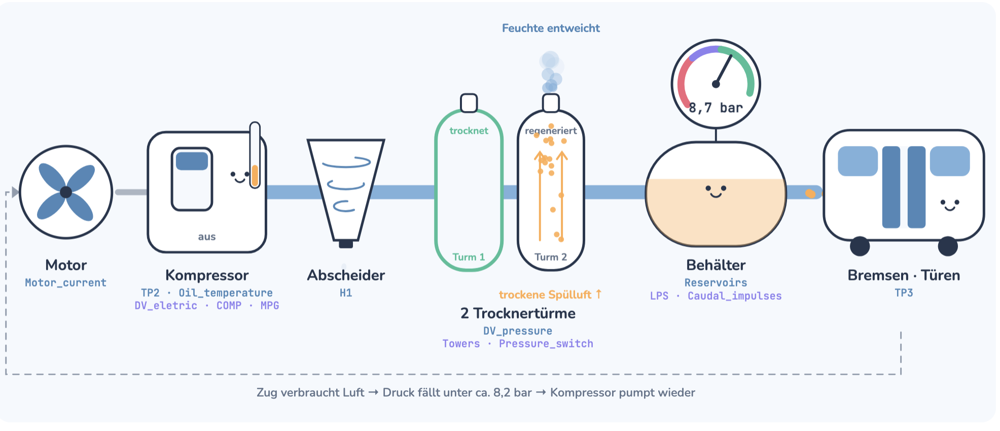

## Industrial IoT: Erkennung von Luftlecks für Predictive Maintenance
# Daten
https://www.kaggle.com/datasets/joebeachcapital/metropt-3-dataset
  Der Datensatz enthält echte Sensordaten (Feb.–Aug. 2020, sekündlich) des Luftkompressors eines Metro-Zugs in Porto. Der Kompressor versorgt Bremsen und Türen mit Druckluft. Im Zeitraum traten 4 Luftlecks auf, dokumentiert in den Wartungsberichten des Betreibers. Ziel ist es, diese frühzeitig zu erkennen, damit der Zug geplant gewartet werden kann, statt im Betrieb auszufallen.
- Echte Daten mit echten Ausfallberichten
- 8 digitale Signale, deren Zustandsänderungen (z. B. Kompressor ein/aus) als Ereignisse für OTALA dienen
- Nur 1 Maschine und 4 Ausfälle.
# Use Cases
1. Anomaly Detection: Erkennung von abnormalem Verhalten des Kompressors, mit SOM (analoge Signale) und OTALA (Schaltzyklen der digitalen Signale)
2. Predictive Maintenance: Frühwarnung vor Luftlecks, damit der Zug geplant in die Werkstatt kann, statt auf der Strecke auszufallen
# Vorgehen:
1. Datenverständnis und -prüfung: Analyse der Signale und der Datenqualität (z. B. Abtastrate ca. 10 s, Datenlücken, Signale, die von der Dokumentation abweichen)
2. Zeitliche Aufteilung: Trainingsdaten = Februar 2020 (keine Ausfälle), Testdaten = März bis August 2020 (enthält die 4 Luftlecks)
3. Datenaufbereitung:
   - Aggregation auf 1-Minuten-Werte
   - Datenlücken markieren und nicht interpolieren
   - Normalisierung, wobei die Parameter nur aus den Trainingsdaten berechnet werden (Vermeidung von Data Leakage)
4. Training (unsupervised): nur mit normalen Daten (Trainingsdaten)
5. Anwendung des Modells auf die Testdaten: Berechnung eines Anomalie-Scores pro Zeitpunkt
6. Evaluation anhand der 4 Luftlecks: Schlägt das Modell während oder vor diesen Zeiträumen Alarm? Wie früh? Gibt es Fehlalarme?

# Failure Events (from maintenance reports)

| Nr. | Start               | End                 | Severity    | Maintenance         |
|-----|---------------------|---------------------|-------------|---------------------|
| #1  | 2020-04-18 00:00    | 2020-04-18 23:59    | High stress | —                   |
| #2  | 2020-05-29 23:30    | 2020-05-30 06:00    | High stress | 2020-04-30 12:00    |
| #3  | 2020-06-05 10:00    | 2020-06-07 14:30    | High stress | 2020-06-08 16:00    |
| #4  | 2020-07-15 14:30    | 2020-07-15 19:00    | High stress | 2020-07-16 00:00    |

# Metro Pipeline

[Interaktive Animation öffnen](metropt_druckluft_de.html)
